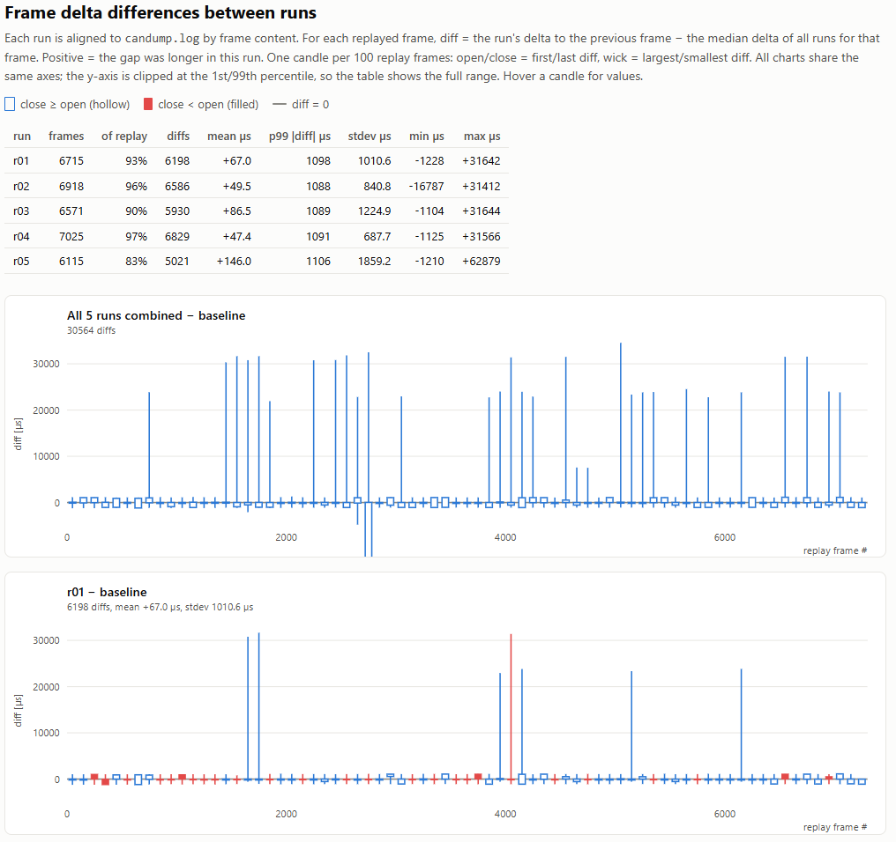

##
```
virtualenv venv
. ./venv/bin/activate
pip install -r requirements.txt
```

## XDP vcan0

```
sudo bash setup_vcan.sh
ip link show vcan0
16: vcan0: <NOARP,UP,LOWER_UP> mtu 72 xdpgeneric qdisc noqueue state UNKNOWN mode DEFAULT group default qlen 1000
    link/can

pushd can-xdp ; make ; popd
~/can-ebpf-rpi4-tests/can-xdp ~/can-ebpf-rpi4-tests
bpftool btf dump file /sys/kernel/btf/vmlinux format c > vmlinux.h.tmp
mv vmlinux.h.tmp vmlinux.h
clang -g -O2 -Wall -target bpf -I . -c can-xdp.bpf.c -o can-xdp.bpf.o
clang -g -O2 -Wall -target bpf -I . -c can-xdp.bpf_1000dropid.c -o can-xdp.bpf_1000dropid.o
clang -g -O2 -Wall -target bpf -I . -c can-xdp.bpf_100dropid.bpf.c -o can-xdp.bpf_100dropid.bpf.o
~/can-ebpf-rpi4-tests

sudo ip link set dev vcan0 xdp obj ./can-xdp/can-xdp.bpf.o sec xdp
ip link show vcan0
16: vcan0: <NOARP,UP,LOWER_UP> mtu 72 xdpgeneric qdisc noqueue state UNKNOWN mode DEFAULT group default qlen 1000
    link/can
    prog/xdp id 375
```

## Run tests
`dump_cycles` runs the canplayer and candump and creates the results in folder `logs`.

```
python dump_cycles.py
--- run 1/5
$ candump -l -T 2000 vcan0 &
$ canplayer -I candump.log vcan0=can0
  canplayer exit 0, candump exit 0, 22.411 s, 286337 bytes -> logs/candump-2026-10-28_172331_r01_T2000.log
--- run 2/5
$ candump -l -T 2000 vcan0 &
$ canplayer -I candump.log vcan0=can0
...

python compare_runs.py
candump-2026-10-28_172331_r01_T2000.log: 6715 frames, 6689 matched to the replay (93%), 6213 deltas
candump-2026-10-28_172331_r02_T2000.log: 6918 frames, 6902 matched to the replay (96%), 6616 deltas
candump-2026-10-28_172331_r03_T2000.log: 6571 frames, 6524 matched to the replay (90%), 5930 deltas
candump-2026-10-28_172331_r04_T2000.log: 7025 frames, 7012 matched to the replay (97%), 6829 deltas
candump-2026-10-28_172331_r05_T2000.log: 6115 frames, 6023 matched to the replay (83%), 5021 deltas
Candlestick chart written to compare_candles.html
```

## Examine
```
python -m http.server 8000
http://X.X.X.X:8000/compare_candles.html
```


